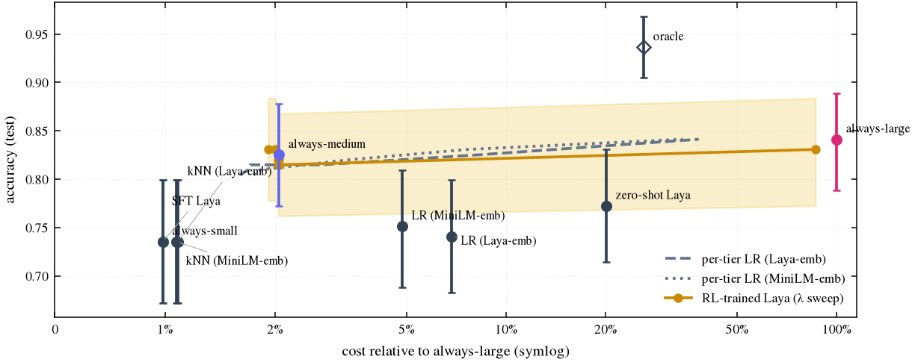

# Pennywise: Jev chooses. This one learns.

Pennywise is an open decision model (Convai's Laya), trained with **reinforcement learning**, that sends each LLM request to the **model tier that will get it right**, with a tool-call cascade that keeps agents moving. You can watch it learn and try to beat it. Plugging it in takes one line.

<!-- GEN:HEADLINE -->
**3.4× faster than Alan's Auto Router, with the same 10/10 agent coding tasks merged.** Pennywise finished all 10 in 11.0 min; Alan Code with Auto Router took 36.9 min (easy 3/3 · medium 3/3 · hard 4/4 for both).

_10 unit-tested agent coding tasks, one run each (Oct 27, 2026). Merged = tests pass and the test file is unchanged. Details, every run and the scripts: [`bench/`](bench/) · [`eval/results/router_bench.json`](eval/results/router_bench.json)._

On held-out Q&A prompts the RL policy (`auto`, λ=0.5) scores 81.5% vs 84.1% for always-large; full table below.
<!-- /GEN:HEADLINE -->

🌐 **Site:** [getpennywise.pages.dev](https://getpennywise.pages.dev) · 📄 **[Technical Report v0.1 (PDF)](web/public/paper.pdf)** (preliminary, not peer-reviewed) · 🎥 **Video:** _TBD_

> **No hosted API.** Hugging Face now requires a paid plan for Docker Spaces, so the router isn't hosted publicly; the site's Live Mode replays real recorded runs. Run the proxy yourself (below): `uvicorn server.app:app --port 8000`.

```python
from openai import OpenAI
client = OpenAI(base_url="http://127.0.0.1:8000/v1", api_key="unused")   # ← the whole integration (your proxy)
client.chat.completions.create(model="auto", messages=[{"role": "user", "content": "..."}])
```

<details><summary>JavaScript</summary>

```js
import OpenAI from "openai";
const client = new OpenAI({ baseURL: "http://127.0.0.1:8000/v1", apiKey: "unused" });
await client.chat.completions.create({ model: "auto", messages: [{ role: "user", content: "..." }] });
```
</details>

`model` can be `auto`, `auto-cheap`, `auto-quality`, or a raw tier (`small` / `medium` / `large`) to bypass routing. Each response says what happened in its headers: `x-router-tier`, `x-router-confidence`, `x-router-latency-ms`, `x-estimated-savings-usd`.

---

## The problem
Coding agents send every call to a frontier model: classification, summaries, one-line fixes, and the genuinely hard reasoning alike. Alan's founder frames AI cost as **dollars per merged PR**. Most of those dollars go to requests a small open model would have answered correctly.

## Alan integration
Alan drives coding-agent CLIs, so the router goes in at the CLI layer:
1. **Cost layer (OpenCode):** [`examples/alan/opencode.json`](examples/alan/opencode.json) adds the proxy as an OpenAI-compatible provider (`pennywise/auto`, etc.). Works with OpenCode directly (`opencode run -m pennywise/auto`, verified). Inside Alan, **Rescan models** does not list custom OpenCode providers (tested 2026-10-26, reported in [`docs/ALAN_FEEDBACK.md`](docs/ALAN_FEEDBACK.md)), so in Alan use route 3 below. The proxy routes **once per agent session** (sticky) and passes tool calls through unchanged, so sessions don't break mid-run. Steps and status are in [`examples/alan/README.md`](examples/alan/README.md); the checks are in [`docs/ALAN_NOTES.md`](docs/ALAN_NOTES.md).
2. **Built with Alan:** not part of this release; see [`docs/DECISIONS.md`](docs/DECISIONS.md).
3. **Agents call the router as a tool:** the [MCP server](integrations/mcp/) (`route`, `ask_routed`) installs in OpenCode next to Alan's own MCP entry, or in Alan itself via **MCP → Add custom connector** (`python -m integrations.mcp.server --http` → `http://127.0.0.1:8765/mcp`).
4. **Alan-style workloads in the data:** 198 auto-graded agent sub-tasks (bug-fix edits graded by unit tests, CI-failure triage graded by construction), reported separately.

### Before/after on agent tasks (small live demo)
<!-- GEN:ALAN -->
**$ per merged PR** (tests pass after the agent's edit), OpenCode with `pennywise/large` (before) vs `pennywise/auto` (after):

| | Tasks passed | Total list-price cost | $ per merged PR | Total wall-clock |
|---|---|---|---|---|
| before: `pennywise/large` | 4/4 | $0.1227 | $0.0307 | 1.9 min |
| after: `pennywise/auto` | 4/4 | $0.0045 | $0.0011 | 65.6 min |

_Small live demo, n = 4 tasks — not a benchmark. OpenCode CLI run directly (the agent CLI Alan drives), not inside an Alan session._ Costs are list prices from measured tokens (actual spend $0). The after-arm's long wall-clock time is the free medium-tier endpoint's latency (often >60 s per step that night), not routing overhead. Raw runs: [`eval/results/alan_before_after.json`](eval/results/alan_before_after.json).
<!-- /GEN:ALAN -->

Before/after on real Alan tasks ($ per merged PR): _pending_. It will be labelled "small live demo, n = 3–5. Not a benchmark."

## Why a decision model is a natural RL policy
[Laya](https://huggingface.co/convaiinnovations/laya) (Apache-2.0, 421M params, ModernBERT-large + decision head) scores every option at its own `[MASK]` marker in **one non-autoregressive forward pass**. With options `{small, medium, large}`, the softmax over those scores is exactly π(a | request). There's no token sampling and no generation, so policy-gradient training is cheap: one pass gives log π for every action.

## How it works
```
request ─▶ proxy ─▶ Laya π(a|s) ─▶ small | medium | large ─▶ answer
                         ▲                                    │
                         └──── reward = correct − λ·cost ◀────┘   (offline: graded outcome table)
```
- **Dataset** ([`data/`](data/)): 948 prompts with automatically checkable answers, an easy + hard mix (a pilot showed current open models saturate the easy benchmarks). GSM8K and MATH-500 levels 4–5 (math), ARC-Challenge and MMLU-Pro (multiple choice), MBPP (unit tests in a sandboxed subprocess), and the agent slice: longer MBPP functions with one or two injected bugs, kept only if the original passes and the mutant fails. Split 60/20/20, stratified by source, seed 0. Every prompt is run on all three tiers and graded.
- **Warm start** ([`router/sft.py`](router/sft.py)): cross-entropy on the oracle tier (cheapest correct tier), training the top 4 encoder layers + Laya's head.
- **RL** ([`router/rl.py`](router/rl.py)): REINFORCE contextual bandit. Sample a ~ π, use **only that arm's** outcome (simulating online feedback even though the offline table has all three), reward `r = correct(a) − λ·cost(a)/cost_ref`, running-mean baseline, entropy bonus annealed 0.05 → 0.005. One policy per λ ∈ {0, 0.1, 0.25, 0.5, 1, 2}. The checkpoint is chosen on val reward, and the test split is never used for selection.
- **Baselines** ([`eval/baselines.py`](eval/baselines.py)): always-small/medium/large, random, oracle, zero-shot Laya, and the cheap embedding baselines a reviewer asks for first. Those are logistic regression and kNN on frozen Laya / MiniLM embeddings, plus **per-tier correctness predictors** swept over the same λ grid (the strongest cheap competitor).

## Results (test split, bootstrap 95% CIs)
<!-- GEN:RESULTS -->
| Policy | Accuracy [95% CI] | Cost vs always-large [95% CI] | Router ms |
|---|---|---|---|
| always-small | 73.5% [67.2%, 79.9%] | 1.0% [0.8%, 1.1%] | 0.0 |
| always-medium | 82.5% [77.2%, 87.8%] | 2.1% [1.8%, 2.3%] | 0.0 |
| always-large | 84.1% [78.8%, 88.9%] | 100.0% [100.0%, 100.0%] | 0.0 |
| random | 79.9% [74.1%, 85.2%] | 41.4% [32.4%, 51.5%] | 0.0 |
| oracle | 93.7% [90.5%, 96.8%] | 26.0% [17.4%, 35.1%] |  |
| zero-shot Laya | 77.2% [71.4%, 83.1%] | 20.1% [12.4%, 28.7%] | 43.9 |
| LR (Laya-emb) | 74.1% [68.3%, 79.9%] | 6.8% [2.6%, 12.4%] | 30.9 |
| kNN (Laya-emb) | 73.5% [67.2%, 79.9%] | 1.1% [0.9%, 1.5%] | 30.9 |
| per-tier LR (Laya-emb) (λ=0.1) | 82.5% [76.7%, 87.8%] | 8.5% [4.2%, 13.4%] | 30.9 |
| per-tier LR (Laya-emb) (λ=0.25) | 81.5% [75.7%, 86.8%] | 2.8% [1.7%, 4.5%] | 30.9 |
| per-tier LR (Laya-emb) (λ=0.5) | 81.5% [75.7%, 86.8%] | 1.8% [1.5%, 2.0%] | 30.9 |
| per-tier LR (Laya-emb) (λ=1) | 81.0% [75.1%, 86.2%] | 1.8% [1.5%, 2.0%] | 30.9 |
| LR (MiniLM-emb) | 75.1% [68.8%, 81.0%] | 4.8% [1.5%, 9.0%] | 6.4 |
| kNN (MiniLM-emb) | 73.5% [67.2%, 79.9%] | 1.1% [0.9%, 1.3%] | 6.4 |
| per-tier LR (MiniLM-emb) (λ=0.1) | 83.1% [77.8%, 88.4%] | 7.6% [3.9%, 12.3%] | 6.4 |
| per-tier LR (MiniLM-emb) (λ=0.25) | 82.0% [76.7%, 87.3%] | 3.4% [2.0%, 5.1%] | 6.4 |
| per-tier LR (MiniLM-emb) (λ=0.5) | 81.0% [75.1%, 86.2%] | 1.9% [1.6%, 2.1%] | 6.4 |
| per-tier LR (MiniLM-emb) (λ=1) | 81.0% [75.1%, 86.2%] | 1.8% [1.6%, 2.1%] | 6.4 |
| SFT Laya | 73.5% [67.2%, 79.9%] | 1.0% [0.8%, 1.1%] | 43.9 |
| RL Laya (λ=0) | 83.1% [77.2%, 88.4%] | 86.2% [78.8%, 92.4%] | 43.9 |
| RL Laya (λ=0.1) | 83.1% [77.8%, 88.4%] | 1.9% [1.7%, 2.2%] | 43.9 |
| RL Laya (λ=0.25) | 82.0% [76.7%, 87.3%] | 2.0% [1.8%, 2.3%] | 43.9 |
| **RL Laya (λ=0.5) ← auto** | 81.5% [76.2%, 86.8%] | 2.0% [1.8%, 2.3%] | 43.9 |
| RL Laya (λ=1) | 82.0% [76.7%, 87.3%] | 2.0% [1.8%, 2.3%] | 43.9 |
| RL Laya (λ=2) | 83.1% [77.8%, 88.4%] | 2.0% [1.8%, 2.3%] | 43.9 |

Jev: not run (no JEV_API_KEY). Full findings, including where the router loses: [`eval/results/summary.md`](eval/results/summary.md).
<!-- /GEN:RESULTS -->



## Honest limitations
- **Small test set:** CIs are wide, and every number above comes with one.
- **Offline bandit:** RL only uses the sampled arm, but the outcome table was collected with full information.
- **Benchmark prompts ≠ production traffic.** The agent slice is synthetic single-function tasks.
- **Single seed.** Multiple seeds are listed as future work.
- **Laya weakens with many options** (per its model card). That's irrelevant at 3 tiers but limits scaling to many models.
- **Jev wasn't benchmarked** unless the table says otherwise.

## Reproduce
```bash
pip install torch --index-url https://download.pytorch.org/whl/cu124 && pip install -r requirements.txt
cp .env.example .env                    # add your provider key(s); fill config/models.yaml
python data/build_prompts.py            # 950 prompts, seed 0
python data/run_models.py               # all prompts × 3 tiers, cached + resumable, $12 budget stop
python -m eval.features                 # embeddings + zero-shot Laya
python -m eval.baselines
python -m router.sft
python -m router.rl                     # one policy per λ; resumable per λ
python -m eval.evaluate                 # CIs, Pareto, summary.md
python -m eval.export_viz               # frontend JSON
python -m router.serve_policy --export  # serving deltas for the auto modes
python paper/build.py                   # technical report
```
Developing without API keys: `SYNTHETIC=1` runs the whole pipeline on a fabricated outcome table under `data/cache/synthetic/`. It's gitignored, the frontend shows a banner, and nothing synthetic can reach the README, paper or launch copy (those scripts refuse).

## Plug in your own models
Edit [`config/models.yaml`](config/models.yaml) (any OpenAI-compatible endpoint, with prices per 1M tokens and `supports_tools: true`), rerun from `run_models.py`, and run `scripts/smoke_tools.py` to check tool calling on every tier.

## Serve
```bash
uvicorn server.app:app --port 8000      # /route /answer /health + /v1/chat/completions, /v1/models
docker build --build-arg SERVE_TGZ_URL=<release asset> -t pennywise .
```
Rate limits, a max prompt length and a daily spend cap (`DAILY_SPEND_CAP_USD`) protect the public demo. When the server is down or capped, the site replays genuine recorded runs and says so.

## Repo map
`data/` dataset + graders · `router/` Laya policy, SFT, RL, serving · `eval/` baselines, evaluation, viz export · `server/` live API + proxy · `integrations/` MCP server + agent skill · `examples/` quickstart + Alan · `web/` Next.js site · `paper/` Typst report · `launch/` X kit · `docs/` notes and the decisions log.

## Decisions log
Highlights are below; the full running log is in [`docs/DECISIONS.md`](docs/DECISIONS.md).
- 4 GB GPU, so train only the top 4 of 28 encoder layers + head. The frozen lower layers are run once and cached (exact up to bf16, 2.5× faster), and offloaded to CPU during training.
- Activation checkpointing took RL's peak VRAM from 3.5 to 2.4 GB, after Windows started spilling into shared memory.
- The proxy's `auto` / `auto-cheap` / `auto-quality` → λ mapping is rule-based and applied to **validation** results only.
- The triage slice asks for the injected *bug type*, not the exception type, because the exception type is printed in the traceback.

---
Built for Openfire. Laya by Convai Innovations (Apache-2.0). Datasets: GSM8K, ARC, MBPP. See the report for references.
